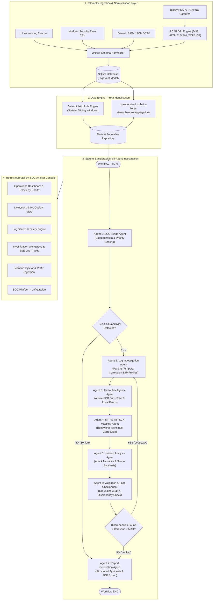

# SENTINEL AI: System Architecture & Engineering Specifications

This document provides a comprehensive technical breakdown of the architectural decisions, state-machine mechanics, detection pipelines, and verification boundaries powering **SENTINEL AI**.

---

## 1. High-Level System Architecture



---

## 2. LangGraph Stateful Multi-Agent Orchestration

### Shared State Model (`AgentState`)
Unlike simple sequential chains or unstructured chat loops, SENTINEL AI agents communicate through a typed, shared Pydantic state definition:

```python
class AgentState(TypedDict):
    investigation_id: str
    title: str
    events: List[Dict[str, Any]]
    alerts: List[Dict[str, Any]]
    triage_verdict: Dict[str, Any]
    log_findings: Dict[str, Any]
    threat_intel_findings: List[Dict[str, Any]]
    mitre_mappings: List[Dict[str, Any]]
    incident_analysis: Dict[str, Any]
    validation_result: Dict[str, Any]
    final_report: Dict[str, Any]
    traces: List[Dict[str, Any]]
    iteration_count: int
    error_logs: List[str]
```

### The 7 Specialized Agents

1. **SOC Triage Agent (`triage_agent.py`)**
   - **Role**: First-line evaluation of alert metadata, triggering telemetry, and system impact.
   - **Logic**: Inspects failure counts, account privileges, and destination IPs to decide if an incident warrants full multi-agent investigation.
   - **Routing**: If flagged benign (e.g. routine automated cron job), routes directly to report generation; otherwise triggers log analysis.

2. **Log Investigation Agent (`log_agent.py`)**
   - **Role**: Temporal analysis and entity extraction using Pandas.
   - **Tools**:
     - `aggregate_event_timeline()`: Reconstructs chronological event streams down to sub-second resolution.
     - `profile_source_ip()`: Identifies targeted users, failure-to-success ratios, and unique port destinations.
     - `extract_suspicious_commands()`: Isolates reconnaissance commands (`whoami`, `id`, `netcat`, `sudo`, `curl`).

3. **Threat Intelligence Agent (`threat_agent.py`)**
   - **Role**: Indicator of Compromise (IoC) reputation checking.
   - **Feeds**:
     - AbuseIPDB REST API (confidence of abuse rating, reports count).
     - VirusTotal API v3 (malicious engine detection ratios).
     - Deterministic offline threat intelligence database with in-memory caching.
   - **Safeguard**: Explicitly marks indicators as `[LIVE FEED]` or `[SIMULATED FEED]` and prevents auto-labeling unrated IPs as malicious.

4. **MITRE ATT&CK Mapping Agent (`mitre_agent.py`)**
   - **Role**: Behavior-to-technique correlation.
   - **Knowledge Base**: Curated local Enterprise matrix containing technique IDs, tactics, and detection patterns.
   - **Safeguard**: Strict grounding prevents hallucination of non-existent technique IDs (e.g., `T1110.001 - Password Guessing`, `T1078 - Valid Accounts`, `T1548.003 - Sudo`, `T1071 - Application Layer Protocol`).

5. **Incident Analysis Agent (`analysis_agent.py`)**
   - **Role**: Kill-chain reconstruction and scope evaluation.
   - **Output**: Determines attack progression (Initial Access -> Execution -> Privilege Escalation -> C2 Beaconing) and computes evidence-backed severity (`INFORMATIONAL`, `LOW`, `MEDIUM`, `HIGH`, `CRITICAL`).

6. **Validation & Fact-Check Agent (`validation_agent.py`)**
   - **Role**: Anti-hallucination verification audit.
   - **Verification Rules**:
     1. Every referenced `event_id` must exist in the raw SQLite database.
     2. Every referenced IP address must appear in the underlying telemetry.
     3. MITRE techniques must be justified by matching evidence strings.
     4. Severity ratings must align with deterministic policy rules.
   - **State Loopback**: If ungrounded assertions are detected and `iteration_count < MAX_ITERATIONS`, routes the workflow back to `log_investigation` for re-analysis.

7. **Report Generation Agent (`report_agent.py`)**
   - **Role**: Structured incident synthesis across 14 enterprise sections.
   - **Export Formats**:
     - Strict JSON export adhering to the Pydantic `IncidentReport` schema.
     - Formatted PDF report via `fpdf2` with sanitized Unicode and typography.

---

## 3. Unsupervised Isolation Forest Machine Learning

### Feature Engineering
For each host $h$, SENTINEL AI aggregates events over a sliding window into a numerical feature vector:

$$\mathbf{x}_h = \begin{bmatrix} 
\text{failed\_logins} \\ 
\text{successful\_logins} \\ 
\text{unique\_source\_ips} \\ 
\text{off\_hours\_ratio} \\ 
\text{unique\_accounts\_targeted} \\ 
\text{sudo\_elevations} \\ 
\text{external\_network\_connections} 
\end{bmatrix}$$

### Model Mechanics
- **Algorithm**: Scikit-learn `IsolationForest(n_estimators=100, contamination=0.1, random_state=42)`
- **Training Baseline**: Trained dynamically on normal enterprise operations telemetry during startup.
- **Explainability (Z-Score Deviation)**: For each feature $j$, the platform calculates the deviation of the anomalous host from baseline mean $\mu_j$ and standard deviation $\sigma_j$:

$$Z_j = \frac{x_{h,j} - \mu_j}{\sigma_j}$$

Features with $Z_j > +2.0$ are surfaced in the UI as the primary contributing dimensions behind the anomaly alert.

---

## 4. Binary PCAP / PCAPNG Deep Packet Inspection (DPI)

SENTINEL AI incorporates a pure-Python binary packet capture parser ([pcap_parser.py](file:///d:/antigrav%20projects/New%20folder%20%282%29/sentinel-ai/backend/app/parsers/pcap_parser.py)) with zero C-library or driver dependencies:

1. **Magic Header Autodetection**:
   - `0xa1b2c3d4` / `0xd4c3b2a1` (Classic PCAP, $\mu s$ timestamps)
   - `0xa1b23c4d` / `0x4d3cb2a1` (Classic PCAP, $ns$ timestamps)
   - `0x0a0d0d0a` (PCAPNG Section Header Block)
2. **Frame Decoders**:
   - Strips 14-byte Ethernet headers (`0x0800` IPv4, `0x86dd` IPv6).
   - Extracts IP protocol flags (TCP=6, UDP=17, ICMP=1).
3. **Application Layer DPI**:
   - **DNS (UDP/53)**: Extracts domain queries using DNS question label decoding.
   - **TLS SNI (TCP/443)**: Parses TLS Client Hello records, scans extension headers (`0x0000`), and extracts the Server Name Indication.
   - **HTTP (TCP/80, 8080)**: Decodes HTTP verbs, URIs, and `Host:` headers.
   - **Reverse Shells**: Detects connections to high-risk C2 ports (`4444`, `1337`, `6667`).

---

## 5. Defensive Guardrails & Human-in-the-Loop Policy

Per standard cybersecurity governance frameworks:
- **Remediation Advisory Only**: AI agents recommend containment and remediation measures (e.g. host isolation, credential revocation), but **cannot autonomously alter firewall rules or execute shell scripts without human sign-off**.
- **Sanitized Upload Ingestion**: Uploaded PCAP, CSV, and text logs are parsed strictly in read-only mode and are never executed.
