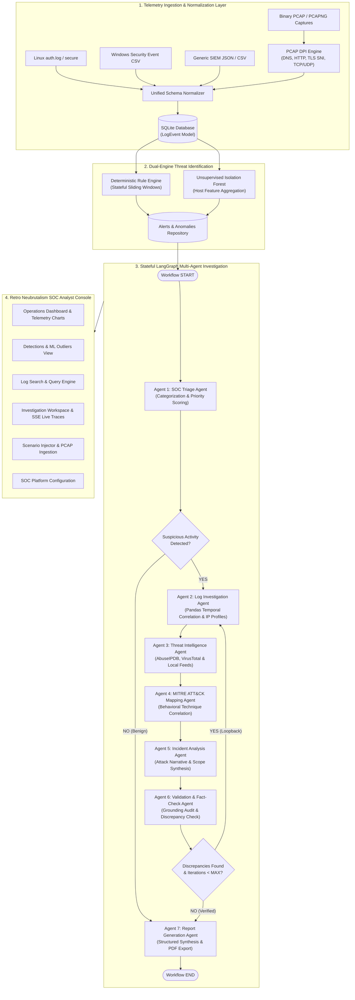

# 🛡️ SENTINEL AI: Autonomous Security Operations & Threat Investigation Platform

[](https://github.com/AnirudhMohite/sentinel-ai/actions)
[](https://www.python.org/)
[](https://fastapi.tiangolo.com/)
[](https://langchain-ai.github.io/langgraph/)
[](https://scikit-learn.org/)
[](https://react.dev/)
[](https://www.typescriptlang.org/)
[](https://tailwindcss.com/)
[](https://opensource.org/licenses/MIT)

> **SENTINEL AI** is a production-style, portfolio-grade Security Operations Center (SOC) autonomous investigation platform powered by **LangGraph** multi-agent state machines, deterministic SIEM rule correlation, unsupervised **Scikit-learn Isolation Forest** telemetry anomaly detection, a pure-Python **binary PCAP Deep Packet Inspection (DPI)** engine, and a **Retro Neubrutalism** analyst interface.

The platform autonomously triages raw security logs and packet captures, maps adversarial behaviors to official **MITRE ATT&CK** Enterprise techniques, cross-references indicator reputations against threat intelligence feeds, audits factual grounding with automated loopback re-investigation, and generates evidence-backed incident reports with human-in-the-loop remediation workflows.

---

## 🏛️ System Architecture



---

## 🔬 4-Tier Analytical Architecture

To ensure operational clarity, SENTINEL AI strictly segregates detection, anomaly discovery, and autonomous investigation:

| Layer | Component | Mechanism | Role / Output |
| :--- | :--- | :--- | :--- |
| **Layer 1** | **Deterministic Detection Engine** | Configurable heuristic rules evaluated over time windows | Identifies known high-confidence attack patterns (SSH brute force, password spraying, Windows 4625 bursts, privilege token assignments). |
| **Layer 2** | **ML Anomaly Detection** | Scikit-learn `IsolationForest` on host feature vectors | Identifies statistical deviations in volume, login hours, unique IPs, and failure ratios. Explains feature deviations using Z-scores. |
| **Layer 3** | **Threat Intel & MITRE Mapping** | AbuseIPDB / VirusTotal + MITRE Enterprise Matrix KB | Correlates indicators against reputation feeds and maps behaviors to validated techniques (`T1110.001`, `T1078`, `T1548.003`, `T1071`). Never invents technique IDs. |
| **Layer 4** | **LangGraph Multi-Agent Orchestration** | Stateful LangGraph directed graph with shared `AgentState` | 7 specialized agents examine metadata, build timelines, evaluate scope, fact-check evidence grounding, and generate comprehensive incident reports. |

---

## 🤖 The 7 Specialized LangGraph Agents

Agents communicate through a typed, shared state object (`AgentState`) rather than plain text strings:

1. **SOC Triage Agent (`triage_agent.py`)**: Receives normalized security telemetry, evaluates event metadata, identifies suspicious patterns, assigns preliminary priority, and decides whether an investigation is required.
2. **Log Investigation Agent (`log_agent.py`)**: Employs **Pandas** analytical tools to correlate authentication sequences, build chronological timelines, profile IP communication patterns, and extract anomalous process parameters.
3. **Threat Intelligence Agent (`threat_agent.py`)**: Cross-references observed source/destination IPs and domains against AbuseIPDB and VirusTotal. Features offline simulated fallback, in-memory caching, rate-limit resilience, and explicit segregation between live and simulated intelligence.
4. **MITRE ATT&CK Mapping Agent (`mitre_agent.py`)**: Evaluates observed behaviors against an authoritative MITRE ATT&CK Enterprise matrix. Returns exact technique IDs, names, tactics, rationales, confidence ratings, and supporting evidence references.
5. **Incident Analysis Agent (`analysis_agent.py`)**: Reconstructs the multi-stage attack sequence (Initial Access -> Execution -> Persistence -> C2), assesses asset scope, and assigns evidence-backed incident severity (`INFORMATIONAL`, `LOW`, `MEDIUM`, `HIGH`, `CRITICAL`).
6. **Validation Agent (`validation_agent.py`)**: Audits factual grounding. Verifies that referenced event IDs and timestamps actually exist in source logs. Triggers an **automated LangGraph loopback** to re-investigate if unsupported conclusions or hallucinations are detected.
7. **Report Generation Agent (`report_agent.py`)**: Assembles the complete 14-section enterprise incident report and exports both structured **JSON** and an official **PDF** report via `fpdf2`.

---

## 📦 Binary PCAP / PCAPNG Deep Packet Inspection (DPI)

SENTINEL AI incorporates a pure-Python binary packet capture parser ([pcap_parser.py](file:///d:/antigrav%20projects/New%20folder%20%282%29/sentinel-ai/backend/app/parsers/pcap_parser.py)) with zero C-driver dependencies:
- **Formats**: Classic PCAP (microsecond and nanosecond timestamps) and PCAPNG enhanced packet blocks.
- **Protocols**: Ethernet, IPv4, IPv6, TCP, UDP, ICMP.
- **Application Layer Inspection**:
  - **DNS (UDP/53)**: Extracts queried domain names (e.g. `evil-c2-beacon.xyz`).
  - **TLS SNI (TCP/443)**: Decodes TLS Client Hello records and extracts Server Name Indication hostnames.
  - **HTTP (TCP/80, 8080)**: Decodes HTTP Request verbs, URIs, and `Host:` headers.
  - **C2 Backdoors**: Identifies reverse shells on high-risk ports (`4444`, `1337`, `6667`).

---

## ⚡ Quickstart Guide

### Option 1: Run with Docker Compose (Recommended)

```bash
# Clone the repository
git clone https://github.com/<your-username>/sentinel-ai.git
cd sentinel-ai

# Build and start all services
docker compose up --build
```
- Frontend UI: `http://localhost:5173`
- Backend API & Docs: `http://localhost:8008/docs`

---

### Option 2: Local Development Setup

#### 1. Prerequisites
- Python 3.11+
- Node.js 18+ (Node 20 recommended) and npm

#### 2. Backend Setup
```bash
cd sentinel-ai/backend

# Create virtual environment
python -m venv venv

# Activate virtual environment
# Windows PowerShell:
.\venv\Scripts\Activate.ps1
# Linux / macOS:
source venv/bin/activate

# Install dependencies
pip install -r requirements.txt

# Run automated test suite (19 tests)
python -m pytest tests -v

# Start backend server
python run_backend.py
```
*Backend runs on `http://127.0.0.1:8008` (API docs at `http://127.0.0.1:8008/docs`).*

#### 3. Frontend Setup
```bash
cd ../frontend

# Install dependencies
npm install

# Verify production build
npm run build

# Start Vite development server
npm run dev
```
*Frontend runs on `http://localhost:5173` with automated API proxy to port `8008`.*

---

## 🎯 1-Click Pre-Packaged Attack Scenarios

SENTINEL AI includes 6 pre-built attack and baseline datasets ready to inject in 1 click:

| Scenario | Name | Format | Vectors Covered |
| :---: | :--- | :--- | :--- |
| **1** | **SSH Brute Force** | `.log` | 18 failed SSH bursts followed by interactive login and privilege reconnaissance. |
| **2** | **Windows 4625 Authentication** | `.csv` | Event 4625 failed logons, Event 4624 success, and Event 4672 special privilege token assignment. |
| **3** | **Privilege Escalation** | `.json` | Sudo execution, secondary staging download via `curl`, and backdoor user creation via `useradd`. |
| **4** | **C2 Outbound Beaconing** | `.csv` | Periodic network beaconing connections to malicious C2 infrastructure. |
| **5** | **Benign Baseline Telemetry** | `.log` | Normal routine employee operations; tests detection precision and zero false-positive rate. |
| **6** | **C2 Packet Capture (PCAP)** | `.pcap` | Binary packet capture containing DNS exfiltration, HTTP stage2 fetch, reverse shell on 4444, and TLS SNI traffic. |

---

## 🌐 REST API Endpoints

| Method | Endpoint | Description |
| :--- | :--- | :--- |
| `POST` | `/api/logs/upload` | Upload & normalize Linux, Windows, JSON, CSV, or PCAP capture files |
| `GET` | `/api/logs` | Query normalized logs with search, severity, and IP filters |
| `GET` | `/api/logs/{event_id}` | Fetch individual log event and raw payload |
| `GET` | `/api/dashboard/summary` | Retrieve SOC KPIs, severity distribution, and activity timeline |
| `GET` | `/api/alerts` | Query rule detections and ML Isolation Forest anomalies |
| `GET` | `/api/alerts/{alert_id}` | Fetch alert details and triggering events |
| `POST` | `/api/investigations/start` | Launch LangGraph multi-agent orchestration for an alert/events |
| `GET` | `/api/investigations` | List investigation history |
| `GET` | `/api/investigations/{id}` | Get investigation summary, agent traces, and report |
| `GET` | `/api/investigations/{id}/trace` | Retrieve step-by-step agent execution log |
| `GET` | `/api/investigations/{id}/report` | Retrieve complete 14-section JSON Incident Report |
| `GET` | `/api/investigations/{id}/report/pdf` | Download formatted executive PDF Incident Report |
| `GET` | `/api/threat-intelligence/{ip}` | Lookup reputation score and category for an indicator |
| `GET` | `/api/scenarios` | List available synthetic attack scenarios |
| `POST` | `/api/scenarios/load/{id}` | Ingest and trigger analysis for a sample scenario |
| `GET` | `/api/settings` | Retrieve active LLM provider and API key configuration |
| `POST` | `/api/settings` | Update LLM provider (Mock/OpenAI), API keys, and thresholds |
| `GET` | `/api/health` | Service health status check |

---

## 🎨 Retro Neubrutalism UI Design

The user interface follows strict **Retro Neubrutalism** principles tailored for cybersecurity operations:
- **Solid High-Contrast Borders**: Sharp 2px and 4px black borders (`border-2 border-black`).
- **Hard Drop Shadows**: Unblurred tactile shadows (`shadow-[4px_4px_0px_0px_#000000]`).
- **Cyber Palette**: Neon Lime (`#bef264`), Electric Cyan (`#67e8f9`), Amber (`#fde047`), Coral Red (`#ef4444`), Purple (`#c084fc`).
- **Monospace Telemetry Badges**: High readability for hashes, IPs, technique IDs, and terminal execution traces.
- **Tactile Micro-Interactions**: Active press-down button effects (`active:translate-x-[2px] active:translate-y-[2px]`).

---

## 🛡️ Defensive Security Governance

- **Human Authorization Mandatory**: AI agents generate remediation recommendations only. No automated firewall modifications, account deletions, or network isolation routines are executed without analyst sign-off.
- **Sandboxed Execution**: Uploaded log files and PCAPs are parsed strictly in read-only mode and are never executed.
- **Zero-Hallucination Grounding**: Every referenced IP, username, timestamp, and technique in the final report is audited against the source database.

---

## 📄 License

This project is licensed under the [MIT License](LICENSE).
